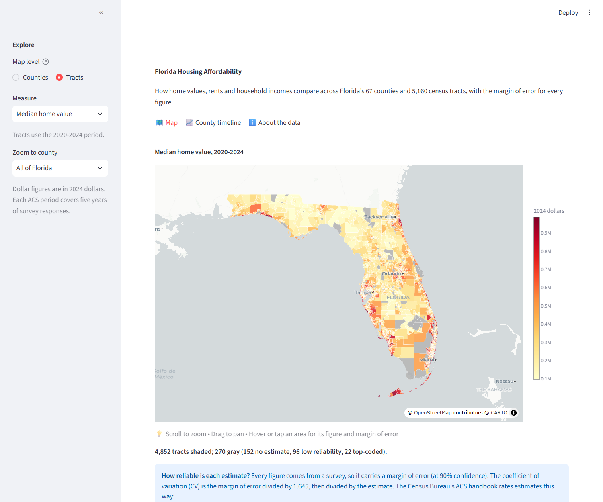

# Florida Housing Affordability

**Live demo:** [florida-housing-affordability.onrender.com](https://florida-housing-affordability.onrender.com/) (free tier, so the first load can take about 30 seconds)



   [](https://github.com/brianravelo28/florida-housing-affordability/actions/workflows/tests.yml)

## Project Details

| | |
|---|---|
| **For** | Renters, buyers, journalists and analysts comparing housing costs and incomes across Florida's counties and neighborhoods |
| **Covers** | Florida's 67 counties in three non-overlapping five-year periods (2010-2014, 2015-2019, 2020-2024) and 5,160 census tracts for 2020-2024, from the Census Bureau's American Community Survey |
| **Built with** | Python, pandas, GeoPandas, Plotly and Streamlit |

## Findings

Between 2010-2014 and 2020-2024, in 2024 dollars:

- **Home values rose much faster than incomes.** Florida's median home value rose 67% (from $214K to $359K) while median household income rose 19% ($62.8K to $74.6K). The median home now costs 4.8 times the median household income, up from 3.4 in 2010-2014 (4.0 in 2015-2019).
- **Rents rose too, and about 6 in 10 renters spend 30% or more of their income on rent.** Median gross rent rose 26% ($1,328 to $1,669 a month). The share of renter households paying 30% or more was 59.0%, 56.3% and 60.1% across the three periods (statewide margin of error about 0.2 percentage points).
- **The gap is widest in the Keys and along the southern coasts.** In 2020-2024 the home value to income ratio is highest in Monroe (8.9), Miami-Dade (6.5), Collier (6.0), Palm Beach (5.4) and Broward (5.3) counties, and lowest in Liberty, Hamilton and Holmes counties (about 2.2). It rose in 63 of 67 counties over the period.
- **Neighborhoods within the same county differ a lot.** Of the 4,771 census tracts with reliable home value and income figures, 36% have a median home value at least 5 times the median household income, and 5.6% at least 8 times.

**Read these with care.** Every figure is a survey estimate with a margin of error; the dashboard shows the margin and a reliability rating for each one, and the statewide figures above are tight (margins under 1%). Each period pools five years of responses, so a figure describes a period, not a single year. Dollar figures are in 2024 dollars; the Census Bureau did not inflation-adjust home values before 2018-2022, so the 2010-2014 and 2015-2019 home values are converted with an average-year factor accurate to about 1 percentage point. The home value to income ratio divides one median by another: it describes places, not what any one household can afford. The numbers show where and when costs differ, not why.

## The dashboard

- **Map:** counties (all three periods) or census tracts (2020-2024), shaded by home value, rent, income, the home value to income ratio, or the share of renters paying 30%+ of income on rent. Hover for the estimate, its margin of error and its reliability rating; zoom to any county. A table view sits under each map.
- **County timeline:** compare counties across the three periods, with error bars for the margin of error.
- **Reliability:** the Census Bureau's ACS handbook rates an estimate by its coefficient of variation (CV, the margin of error divided by 1.645, divided by the estimate): **under 12%** high reliability, **12% to 40%** moderate, **over 40%** low. Areas with low reliability, no estimate or a top-coded value are drawn gray. The cutoffs are the handbook's convention, not a formal standard; the dashboard spells them out under every map.

## The data

U.S. Census Bureau American Community Survey 5-year estimates, pulled directly from the Census Bureau Data API: median home value (B25077), median gross rent (B25064), median household income (B19013) and rent as a share of income (B25070). The cleaning rules, with the number of areas each one affects, are in [`docs/METHODOLOGY.md`](docs/METHODOLOGY.md); sources, retrieval dates and terms are in [`docs/CITATIONS.md`](docs/CITATIONS.md).

*This product uses the Census Bureau Data API but is not endorsed or certified by the Census Bureau.*

## Run it

```bash
pip install -r requirements.txt
streamlit run app.py                # opens at http://localhost:8501
```

The processed data is committed (`data/processed/`), so the app runs without an API key.

## Rebuild the data

Get a free key from the [Census Bureau](https://api.census.gov/data/key_signup.html) and set it as the `CENSUS_API_KEY` environment variable (or put it in a git-ignored `.env` file).

```bash
pip install -r requirements-pipeline.txt     # adds requests and GeoPandas
python run_pipeline.py                       # fetch, clean, prepare boundaries
python src/findings.py                       # the numbers quoted above
```

## Tests

```bash
pip install -r requirements-dev.txt
python -m pytest
```

The tests run offline with small hand-built data, no API key needed. They cover each cleaning rule (special values, top-coding, reliability bands at their edges, dollar conversion, the margin-of-error formula), the add-up checks, which areas the map shades or grays and what each hover says, the fetching code (including that the API key is never stored), and that the numbers in this README match the data. GitHub Actions runs them on every push. They do not cover the Streamlit interface itself.

## Structure

```
├── app.py                  # Streamlit dashboard
├── run_pipeline.py         # Rebuilds data/processed from the Census Bureau API
├── src/
│   ├── acs_config.py       # Periods, tables, special values, dollar factors
│   ├── fetch_acs.py        # Census API pulls and the manifest
│   ├── clean.py            # Cleaning, reliability, dollars, derived measures
│   ├── geometry.py         # Simplified county and tract boundaries
│   ├── view.py             # Which areas are shaded or gray, and the hover text
│   └── findings.py         # The numbers quoted in this README
├── data/
│   ├── manifest.json       # What was pulled, when, with checksums
│   └── processed/          # Cleaned tables, boundaries, cleaning log, findings
├── tests/
└── docs/                   # METHODOLOGY, CITATIONS, DEPLOYMENT, screenshot
```

## License

Code: MIT, see [LICENSE](LICENSE). Data: U.S. Census Bureau and Bureau of Labor Statistics public data, cited in [`docs/CITATIONS.md`](docs/CITATIONS.md).
